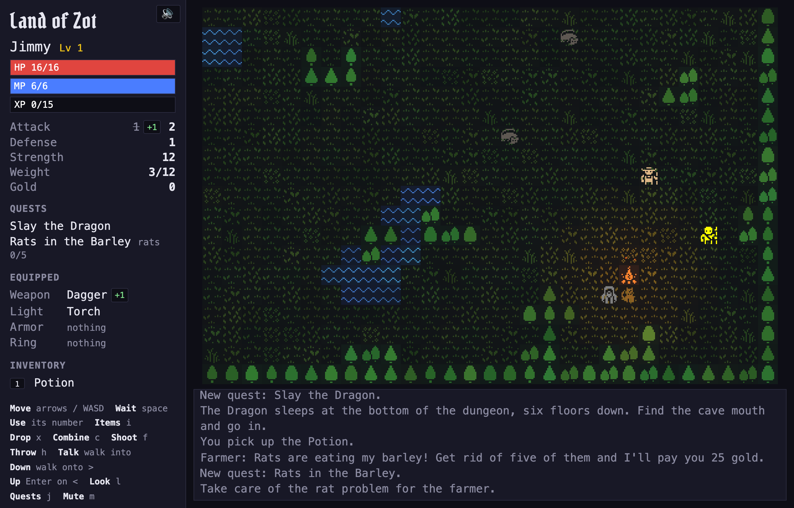
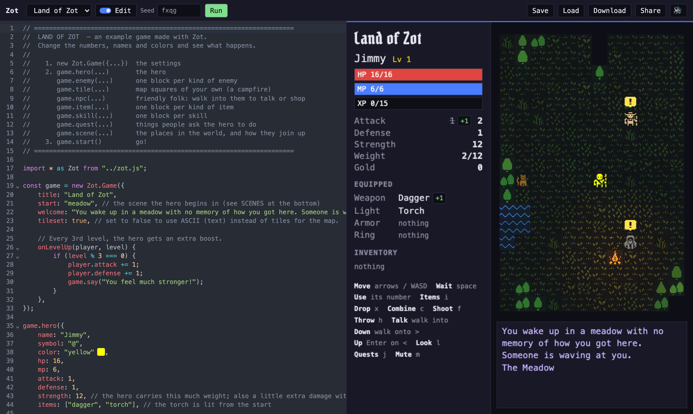
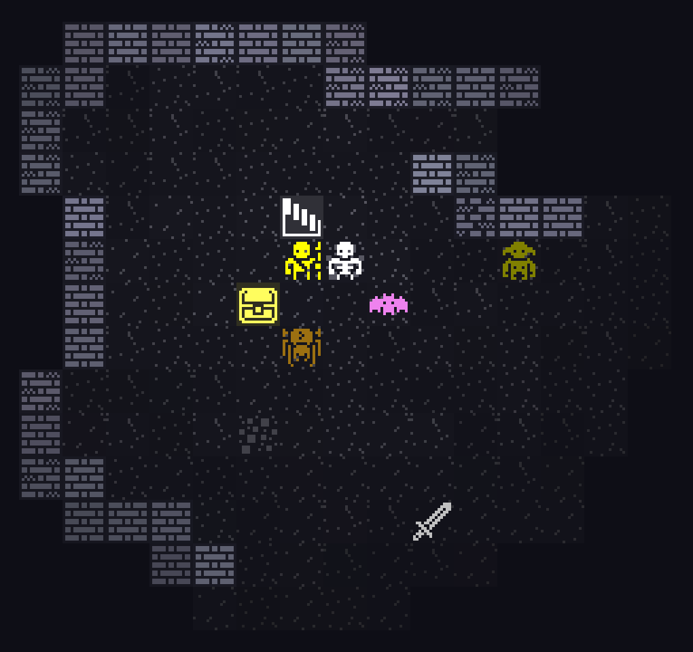
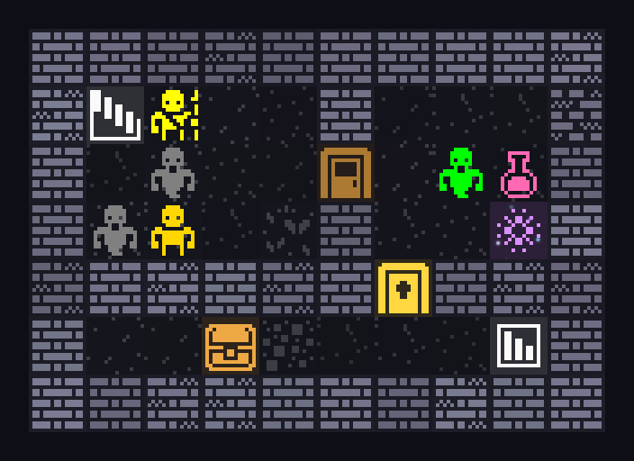

# Zot



Zot is a library and web app for making (and playing) dungeon crawler games in the browser, and possibly also teach some coding basics along the way. It sits on top of the [rot.js](https://ondras.github.io/rot.js/hp/) library.

## Quick start


You describe your game with plain JavaScript objects:

```js
import * as Zot from "./zot.js";

const game = new Zot.Game({ title: "My Dungeon" });

// your game definitions: hero, enemies, items, scenes, etc.

game.enemy("goblin", {
	symbol: "👺", // or a letter, like "g"
	color: "lime",
	hp: 6,
	attack: 3,
	xp: 5,
});

game.start();
```

### Running the server locally

`npm run dev`

### Example games:

- `examples/starter.js`: a hero, an enemy and an item.
- `examples/campfire.js`: the starter with gear, skills, a map square and a quest.
- `examples/puzzle-room.js`: one room with no fighting and different kinds of switches, locks and puzzles.
- `examples/land-of-zot.js`: a whole game with an overworld, cottage, dungeon, and boss battle.



## The game

```js
const game = new Zot.Game({
	title: "My Dungeon",
	scenes: 5, // if you just want a 5-level dungeon to explore
	welcome: "You wake up in a meadow...",
});
```

## The hero

```js
game.hero({
	name: "Hero",
	symbol: "@",
	color: "yellow",
	hp: 16,
	mp: 6, // magic points, for skills
	attack: 2,
	defense: 1, // comes off every hit taken
	strength: 12, // how much the hero can carry; every 4 gained add 1 to a weapon hit
	items: ["dagger", "torch"], // to start with; gear is worn
	// skills: ["heal"],            // known from the start
	// gold: 20,
	// sight: 8,                    // squares seen
	onHurt(player, attacker, damage) {
		if (Zot.chance(10)) {
			game.say("You dodge the attack!");
			return 0; // a number changes the damage; 0 is a dodge
		}
	},
});
```

## Enemies

```js
game.enemy("skeleton", {
	symbol: "s",
	color: "white",
	// tile: [26, 2],               // with pictures: column 26, row 2 of tiles/guide.png
	hp: 12,
	attack: 5,
	defense: 2,
	xp: 10, // what the hero gets for killing it
	level: { from: 2 }, // where it turns up: 3, [2, 5] or { from, to }; leave out for everywhere
	// scenes: ["mine", "lair"],    // or these named scenes
	rarity: "uncommon", // "common" (10), "uncommon" (4), "rare" (2), "legendary" (1)
	drops: { bone_sword: 20 }, // percent chances, one roll
	// speed: 2,                    // two turns to the hero's one
	// sight: 7,                    // how far it notices the hero
	// ai: "wander",                // "chase" (hunts on sight), "wander", "still" or "flee"
	// verb: "bites",               // "The skeleton bites you"
	// shoots: "arrow", range: 6,   // fires at the hero when they're in a straight line; never runs out
	// unique: true,                // only where you put it: a boss, a legend, scene.spawn()
	// beside: "campfire",          // a tile put next to it
});
```

## Fighting

Walking into an enemy hits it. A hit rolls between half the attacker's `attack` and all of it, minus the defender's `defense`, at least 1.



```js
const game = new Zot.Game({
	damage: (attacker, defender, melee) => Math.max(1, attacker.attack - defender.defense), // no dice; melee is false for an arrow or a spell
	levelUp: { xp: (level) => level * 20, hp: 4, attack: 1, defense: 0, strength: 1, mp: 2 }, // what a level costs and gives
});

game.enemy("snake", {
	symbol: "S",
	color: "green",
	hp: 6,
	attack: 2,
	verb: "bites",
	onAttack(snake, target, damage) {
		// then the target's onHurt(target, snake, damage); either may return the new damage
		if (damage > 0 && Zot.chance(33)) {
			game.say("The bite is venomous!");
			return damage + 2;
		}
	},
	// onKill(snake, victim) {},    // onDie(snake, killer) on the other side
});

game.enemy("bat", {
	symbol: "b",
	color: "gray",
	hp: 4,
	attack: 1,
	speed: 2,
	act(bat) {
		// its own brain, each turn, instead of ai
		const hero = game.player;
		if (bat.isNextTo(hero) && Zot.chance(50)) bat.hit(hero);
		else bat.wander();
	},
});
```

## Items

```js
game.item("potion", {
	symbol: "!",
	color: "hotpink",
	price: 12, // what a shop charges; the hero sells for half
	onUse(player, item) {
		player.heal(Zot.random(8, 12));
	},
	// count: 2,                    // how many come in a pile
	// consumable: false,           // kept after use
	// keep: false,                 // used on the spot when picked up, like gold
	// rarity, level, scenes, unique as for enemies
});

game.item("sword", {
	slot: "weapon", // "weapon", "armor", "light", "ring" or your own; worn gear adds its numbers
	symbol: "/",
	color: "silver",
	attack: 3, // also defense, strength, maxHp, maxMp, speed, sight
	weight: 2, // the hero carries up to their strength
	price: 40,
	// light: 3,                    // lights this many squares in the dark
	// lasts: 100,                  // turns worn before it is gone: a torch
	// shoots: "arrow", range: 6,   // fires one at the closest enemy in line
	// throw: 4,                    // h throws one this far; it hits with its own attack, and is gone
	// onEquip(player, item) {},    // onUnequip, onPickup, onWearOut
	// onHit(player, target, damage, item) {}, // after it hits for some damage, wielded, thrown or shot
});
```

## Gear modifiers

A gear modifier is an occasional twist found on gear (e.g. "Enchanted Sword").

```js
game.gearModifier("enchanted", {
	weapon: { attack: 1 }, // only on weapons; a number adds, a function gets the old value
	armor: { defense: 1 },
	price: (p) => p * 2, // on anything it lands on
	// color: "gold",               // a word replaces
	// rarity: "rare",              // "uncommon" unless it says
	// level: { from: 3 },
});

game.gearModifier("elvish", {
	slot: ["weapon", "armor"], // which gear it goes on; without one, anything worn
	weight: (w) => w / 2,
});
```

## Recipes

The `c` key opens the Combine screen.

```js
game.recipe("torch", {
	combine: ["stick", "rag"],
});
game.recipe("spear", {
	combine: ["stick", "knife", "rope"], // a name twice for two of them
	say: "You lash the knife to the stick.",
	onMake(player, item) {
		player.equip(item);
	},
});
game.recipe("arrow", {
	combine: {
		stick: 1,
		feather: 2,
	},
	count: 3, // how many are made
});
```

## Map squares

```js
game.tile("campfire", {
	symbol: "^",
	color: "#ff9b3d",
	walkable: false,
	// seeThrough: false,
	light: 5, // lights the squares around it in the dark
	glow: "#ff8a1f", // a color that flickers over them
	fx: "sparks", // played on the square: "sparks" fly up from it, a "swirl" circles in toward its middle
	// exactColor: true, // no color variations
	// ground: true, // things can be placed on it at random
	onBump(player, x, y, game, here) {
		game.say("The fire crackles. It's warm.");
		return false; // no turn passes
	},
	// onStep(player, x, y, game, here) {},
});
```

`here` is the square: `here.scene`, `here.x`, `here.y`, and `here.flags`, a notepad for that one square that stays when its tile changes. A scene's `squareAt(x, y)` and `tilesNamed(...)` give the same squares. One way to hide a potion in one bookshelf of many:

```js
game.tile("bookshelf", {
	symbol: "b",
	walkable: false,
	onBump(player, x, y, game, here) {
		if (!here.flags.holds) return game.say("Just books.");
		game.give(here.flags.holds);
		here.flags.holds = null;
	},
});

game.scene("library", {
	map: `...`,
	legend: {
		b: "bookshelf",
		B: { tile: "bookshelf", flags: { holds: "potion" } }, // this one, or...
	},
	onEnter(scene) {
		// ...one picked at random, the same one for the same seed
		Zot.pick(scene.tilesNamed("bookshelf")).flags.holds = "potion";
	},
});
```

You can also modify any of the built-in tiles.

```js
game.tile("wall", { color: "blue" });
```

## Non-player characters

```js
game.npc("merchant", {
	symbol: "M",
	color: "gold",
	says: ["Welcome, traveler! Have a look.", "Back again? Good."], // one line per visit, round again
	stock: ["torch", "potion", "sword"], // makes it a shop
	comment: "My prices are fair!", // shown in the shop
	// prices: { sword: 50 },       // this shop's own prices
	// quest: "rats",               // handed out the first time you talk
	// beside: "campfire",          // a tile put next to it
	// ai: "wander",                // strolls about; "still" unless it says
	// onTalk(npc, player, game) {},  // return a line to say, or false to stop there
});
```

## Quests

```js
game.quest("rats", {
	name: "Rats in the Barley",
	kill: { rat: 5 }, // or bring: { gem: 3 }, or reach: "lair"
	reward: { gold: 25 }, // also xp, items
	ask: "Rats are eating my barley! Get rid of five of them and I'll pay you 25 gold.",
	wait: "Still rats in the barley. Five of them, then we talk.",
	thanks: "That's the rats sorted. Here, as promised.",
	// report: false,               // done the moment the goal is met, no need to go back
	// onDone(player, quest) {},    // and onStart
});
```

## Skills

Skills are magic powers that typically use up MP when used.

```js
game.skill("fireball", {
	mp: 5, // what it costs
	cooldown: 4, // turns before it can be used again
	target: true, // needs an enemy in sight
	range: 6, // how far away that enemy may be
	learnAt: 3, // the level it is learned at; or list it in the hero's skills
	// key: "f",                    // the key that uses it; else the next free number
	onUse(player, enemy) {
		game.say(`A fireball flies at ${enemy.label}!`);
		enemy.hurt(Zot.random(6, 12), player);
	},
});
```

You can also choose to make a skill discovered, for example by reading a scroll:

```js
game.item("scroll_of_fire", {
	symbol: "?",
	color: "orange",
	unique: true, // only where you put it, like the chest below
	onUse(player) {
		if (player.knows("fireball")) return false; // keeps the scroll
		player.learn("fireball"); // "You learn Fireball!"
	},
});

game.scene(2, { chests: ["scroll_of_fire"] });
```

## Effects

An effect stays with a creature for a few turns, like being poisoned, on fire or hasted. Zot has none built in; you make your own.

```js
game.effect("poisoned", {
	turns: [4, 7], // how many of its turns it lasts: a number, or a range rolled each time; leave out for until removed
	color: "lime", // the creature is drawn in this color while it lasts
	fx: { color: ["#7cff6b", "#3fd13a"], rise: 10, rate: 3 }, // green bubbles rising off it
	onTurn(creature, effect) {
		creature.hurt(1, effect.from); // effect.turns is how many are left, effect.from who put it on
	},
	// onStart(creature, effect) {}, onEnd(creature, effect) {}
});

game.effect("burning", {
	turns: 3,
	glow: "orange", // flickers over it and the squares around it, like a campfire's glow
	fx: "sparks", // a built-in fx, or dots of your own as above
	onTurn(creature, effect) {
		creature.hurt(2, effect.from);
	},
});

game.enemy("snake", {
	onAttack(snake, target, damage) {
		if (Zot.chance(33)) target.addEffect("poisoned", { from: snake });
	},
});
```

`creature.addEffect("burning", 5)` puts one on for 5 turns instead. One it already has lasts the longer of the two. `creature.hasEffect(name)` and `creature.removeEffect(name)` check for one and take it off (a cure). The hero's effects show on the side panel.

An effect can also add to the creature's numbers while it lasts, the way worn gear does, and light the dark like a worn light:

```js
game.effect("hasty", {
	turns: 10,
	speed: 1, // twice as fast; also attack, defense, strength, maxHp, maxMp, sight
	onEnd(creature) {
		if (creature.isPlayer) game.say("You slow down again.");
	},
});

game.effect("radiant", {
	turns: 90,
	light: true, // sees normally in the dark; or a number of squares
	sight: 8,
});

game.skill("haste", {
	mp: 4,
	cooldown: 20,
	onUse(player) {
		player.addEffect("hasty");
	},
});
```

## Scenes

A scene is a map. It can be a floor of a dungeon, a town, an overworld. Numbered scenes are a chain where each one's stairs lead to the next level. Named scenes are joined by their exits.

```js
game.scene("meadow", {
	name: "The Meadow",
	map: "overworld", // "dungeon", "rooms", "cave", "maze" or "overworld"
	width: 90,
	height: 40,
	npcs: ["old_man", "farmer"], // placed near where the hero arrives
	exits: { down: "mine" }, // "down" is the >, "up" the <, any other name a portal (with a swirl of motes over it)
	// enemies: 3, items: 2,        // how many to add at random
	// dark: 2, fog: false,         // this scene's own
	// onEnter(scene, game) {},     // the first time the hero arrives
});

game.scene("mine", {
	name: "The Old Mine",
	level: 2, // how tough: what enemies' and items' level go by
	exits: { up: "meadow", down: "lair", shortcut: "town" },
});

game.scene("town", {
	exits: {
		shortcut: { to: "mine", at: "shortcut" }, // arrive on that exit over there
		house: { to: "house", at: "door", tile: "cottage" }, // a solid tile is walked into, and the hero arrives in front of it
	},
});

game.scene("lair", {
	name: "The Dragon's Lair",
	map: "rooms",
	boss: "dragon", // in the room the way down is in
	treasure: ["potion", "potion"], // beside the boss
	exits: { up: "meadow", gate: { to: "meadow", win: true } }, // taking it wins
	// vault: { key: "iron_key", treasure: ["sword"], guards: ["ogre"] }, // a locked room; the key is dropped elsewhere in the scene
});
```

A scene can be drawn by hand, one letter per square:

```js
game.scene("mine", {
	name: "The Old Mine",
	exits: { up: "meadow", down: "caves", shortcut: "town" },
	map: `
		##########
		#<...#...#
		#....+.g.#
		#.M..#..O#
		######L###
		#..=....>#
		##########
	`, // # wall . floor + door < > stairs = chest ~ water T tree , grass @ where the hero arrives
	legend: {
		g: "goblin", // an enemy, npc, item or tile by name
		M: "merchant",
		L: { tile: "lockedDoor", key: "iron_key" },
		O: { tile: "portal", exit: "shortcut" },
		// s: { tile: "grass", on: "gull" } // a thing standing on a tile
		// b: { tile: "bookshelf", flags: { holds: "potion" } } // the square's flags
	},
	chests: ["torch"], // what each chest holds, in reading order
	enemies: 2, // added at random on top
	items: 1,
	// ground: "sand",              // what drawn things stand on, instead of floor
});
```



## Useful functions

Game-wide functions:

- `game.say(text)` writes to the log
- `game.win(text)` and `game.lose(text)` end the game
- `game.give(name)` puts an item straight into the hero's pack
- `game.combine(["stick", "rag"])` makes what those add up to, out of the hero's pack; `game.craft()` opens the Combine screen
- `game.alert(creature)` shows the "!" over a creature for a moment
- `game.dissolve(ms, then)` takes the map away for `ms` milliseconds, then runs `then` (a night's sleep)
- `game.after(turns, fn)` runs `fn` once that many of the hero's turns have passed (a spell wearing off)
- `game.flags` is a notepad for your own game: `game.flags.metTheKing = true`
- `Zot.random(6)` is 1 to 6, `Zot.random(2, 5)` is 2 to 5, `Zot.chance(25)` is true 25% of the time

Scene-specific functions:

- `scene.tileAt(x, y)` is the name of the tile on a square, `scene.setTile(x, y, "floor")` changes it, and `scene.tilesNamed("lamp", "lampOn")` is every square that is one of those tiles
- `scene.squareAt(x, y)` is a square as `{ x, y, scene, flags }`, and `scene.flagsAt(x, y)` its flags
- `scene.spawn(name, x, y)` puts an enemy or npc down
- `scene.drop(name, x, y)` drops an item
- `scene.chest(x, y, ["potion"])` places a chest
- `scene.creatureAt(x, y)` and `scene.itemAt(x, y)` are who and what is on a square; `scene.enemies`, `scene.npcs` and `scene.items` are everyone and everything there
- `scene.addFx(x, y, "sparks")` and `scene.removeFx(x, y, "sparks")` start and stop an fx (sparks, a swirl) on a square

## Credits

- Extends and is heavily influenced by [rot.js](https://github.com/ondras/rot.js) by Ondřej Žára, BSD-3-Clause
- The tile sheet is [Kenney's 1-Bit Pack](https://kenney.nl/assets/1-bit-pack), CC0, with a few squares of Zot's own added by `tiles/build.py`.

## License

[MIT](LICENSE).
